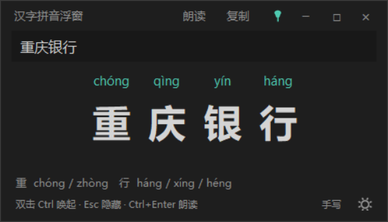
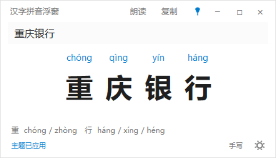
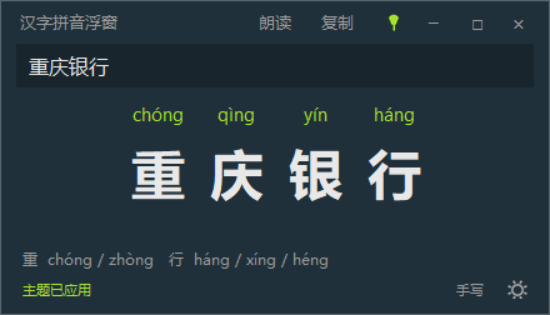
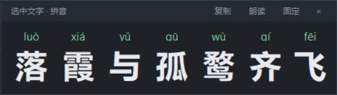
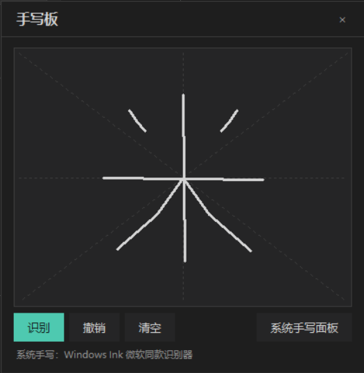
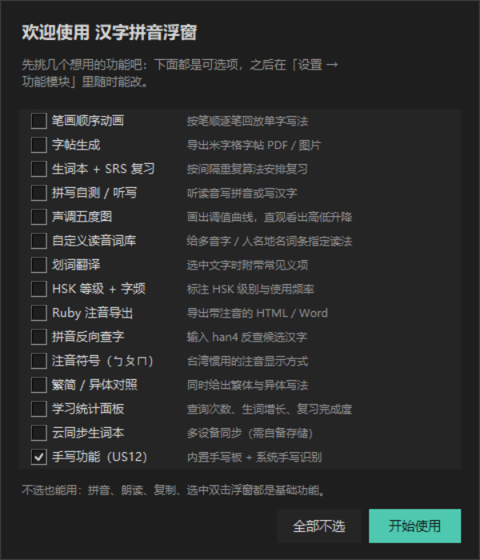
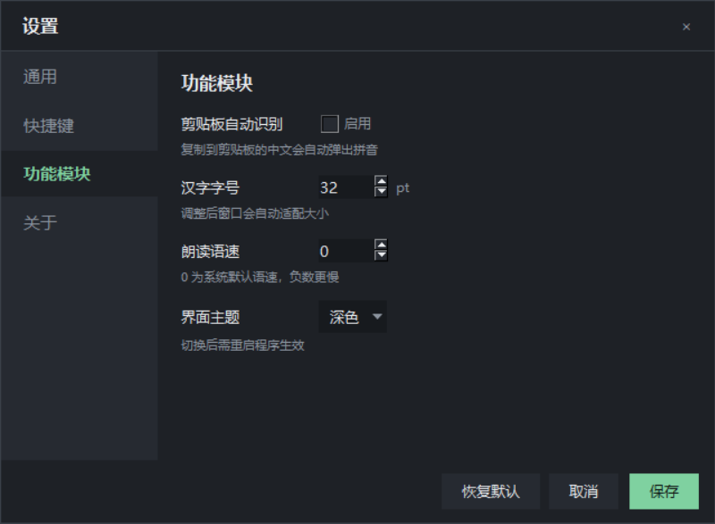
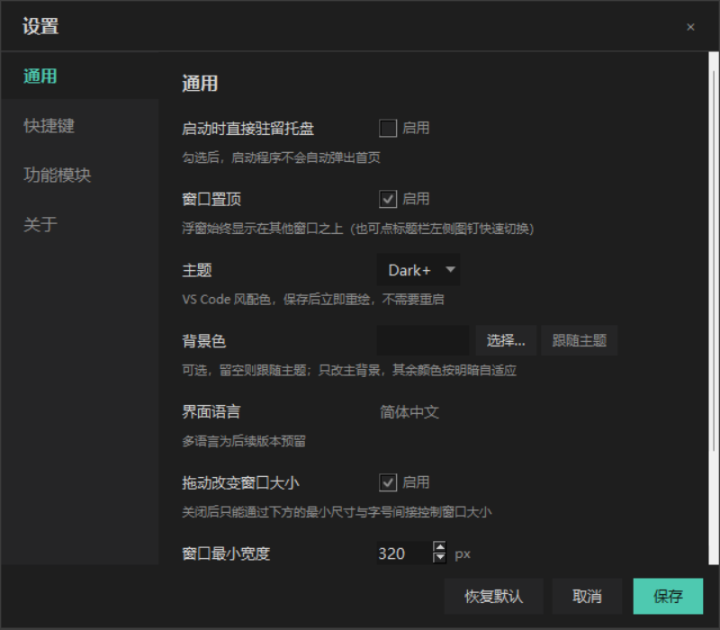
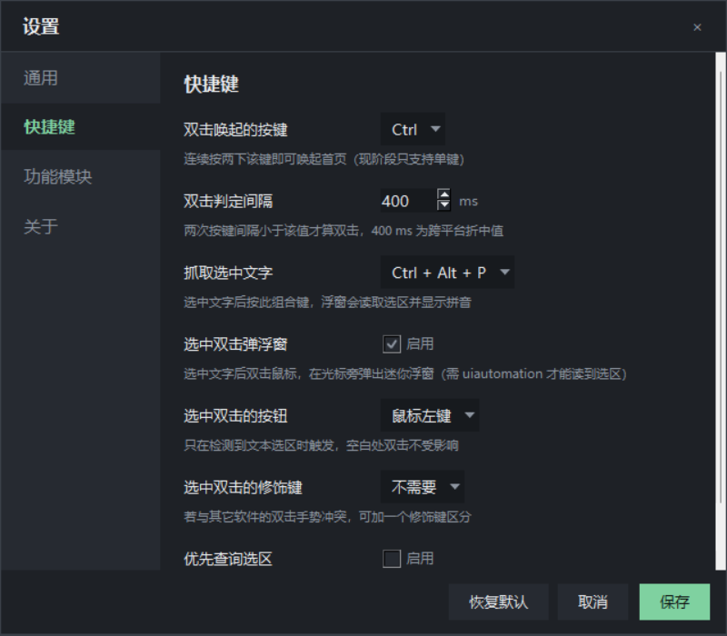

# 汉字拼音浮窗 · Hanzi Pinyin Popup

> 一个常驻 Windows 托盘的汉字工具：**写一个字 / 选中一段字，立刻看到带声调的拼音**，还能朗读、复制、点单字反复听。
> 本地运行、不联网、不上传任何文字。MIT 许可。




---

## 目录

- [它解决什么问题](#它解决什么问题)
- [核心功能](#核心功能)
- [界面预览](#界面预览)
- [快速开始](#快速开始)
- [怎么用](#怎么用)
- [快捷键一览](#快捷键一览)
- [设置项](#设置项)
- [主题与配色](#主题与配色)
- [可选功能模块](#可选功能模块)
- [配置文件](#配置文件)
- [项目结构](#项目结构)
- [实现要点](#实现要点)
- [常见问题](#常见问题)
- [已知限制](#已知限制)
- [路线图](#路线图)
- [开发与迭代](#开发与迭代)
- [许可证](#许可证)

---

## 它解决什么问题

遇到不认识的字，最省事的办法是"写一遍"。但**微软拼音的手写面板只认得字，不告诉你读什么**，还得再复制去查。

这个小工具把最后一段补上了：

1. 系统手写面板写字 → 字落进输入框；
2. 浮窗立刻在字上方标出拼音（多音字全列）；
3. 点单字能听读音，一键复制纯拼音或「字 + 拼音」对照表。

也可以直接把字打进输入框，或者在任意软件里选中文字后**双击鼠标**、在光标旁弹出迷你浮窗。

---

## 核心功能

**看拼音**
- 带声调符号显示（hàn / han4 / han 三种写法可切）
- 多音字全列，点字切换并朗读
- 词组消歧：「重庆」读 chóng qìng，「银行」读 yín háng
- 非中文内容自动过滤：`Hello 你好 123！` → 只标注「你好！」

**随手就查**
- 双击 `Ctrl` 唤起首页（按键与间隔可改，也可关掉）
- 选中文字后**双击鼠标**（或连续按两下 `Shift`），光标旁弹出迷你浮窗
- 迷你浮窗可拖动、可固定、超时自动淡出、**点外面自动消失**
- 可选：剪贴板一出现中文就自动弹窗

**听与复制**
- Windows SAPI 朗读，嗓音 / 语速可选
- 点单字朗读，多音字顺便切到下一个读音
- 复制纯拼音，或复制「字 ⇥ 拼音」对照
- 抓取选区时不破坏你原来的剪贴板内容

**窗口与外观**
- 无边框窗口，8 向拖动改大小，尺寸与位置记忆
- 标题栏：`📌 置顶 | − 托盘 | □ 最大化 | × 退出`
- 5 套 VS Code 风配色（默认 Dark+），可自定义背景色，保存即生效
- 首次启动引导页：勾选想用的模块，之后在设置里随时增删

---

## 界面预览

| 浅色主题（Light+） | 自定义背景（Monokai + 深青底） |
| --- | --- |
|  |  |

| 选中双击弹出迷你浮窗 | 内置手写板 |
| --- | --- |
|  |  |

| 首次启动引导 | 功能模块开关 |
| --- | --- |
|  |  |

设置界面（通用 / 快捷键 / 功能模块 / 关于，内容区可滚动）：




---

## 快速开始

### 方式零：下载现成的 exe（零环境，双击即用）

到 [Releases](https://github.com/LVE0CL/hanzi_pinyin/releases) 下载，两种包任选：

| 下载 | 大小 | 说明 |
| --- | --- | --- |
| `HanziPinyinPopup-portable.exe` | ~21 MB | **单文件版**。双击即用，只有一个文件。首次启动要先自解压到临时目录，约 2–5 秒（机械盘或杀软实时扫描时更久），这段时间屏幕上是没有任何反应的，不是打不开。 |
| `HanziPinyinPopup-v1.2.1-win64.zip` | ~21 MB | **绿色版**。解压后双击里面的 `HanziPinyinPopup.exe`，启动最快（约 1 秒）。注意 **exe 必须和同目录的 `_internal` 文件夹放在一起**，只把 exe 单独拷走会报「找不到 python3xx.dll」。 |

两个包都已内置 Python 解释器和 VC++ 运行库，**不需要装 Python、不需要装运行库、不需要管理员权限、不写注册表**。

> 首次运行 Windows 可能弹 SmartScreen「Windows 已保护你的电脑」——点「更多信息 → 仍要运行」即可。程序不联网、不上传任何文字。

### 方式一：跑源码（想改代码时用）

```bash
git clone https://github.com/LVE0CL/hanzi_pinyin.git
cd hanzi_pinyin
python -m venv .venv
.venv\Scripts\activate          # macOS / Linux: source .venv/bin/activate
pip install -r requirements.txt
python hanzi_pinyin.py
```

Windows 上也可以直接双击 `start.bat`（会检查依赖并用 `pythonw` 启动，不弹黑框）。

### 方式二：自己打成 exe

```bash
pip install pyinstaller

# 绿色版（目录形式，启动快）
pyinstaller --noconfirm --windowed --noupx --collect-submodules hpp.features \
    --name HanziPinyinPopup hanzi_pinyin.py
# 产物：dist/HanziPinyinPopup/HanziPinyinPopup.exe（需与 _internal 同目录）

# 单文件版
pyinstaller --noconfirm --windowed --noupx --onefile --collect-submodules hpp.features \
    --name HanziPinyinPopup-portable hanzi_pinyin.py
```

> **`--collect-submodules hpp.features` 不能省**：功能模块是按 `<key>.py` 动态 import 的，
> PyInstaller 静态分析看不到它们，不打包进去的话运行时只剩开关、面板全空
> （`--selftest` 会以「S4 已实现模块可加载」失败告警）。
>
> 加 `--noupx`：UPX 压缩会让启动变慢，也更容易被杀软误报。
> **不要把 `--distpath` / `--workpath` 指到中文长路径下**，Windows 上 PyInstaller 拷贝 DLL 时会报 `PermissionError`，换到 `C:\build` 这类短路径即可。

### 依赖

| 包 | 用途 |
| --- | --- |
| `pypinyin` | 拼音与多音字、词组消歧 |
| `pyperclip` | 跨平台剪贴板 |
| `pynput` | 全局按键 / 鼠标监听 |
| `pystray` | 系统托盘图标与菜单 |
| `pillow` | 图标与齿轮 / 图钉位图绘制 |
| `uiautomation` | 仅 Windows：用 UI Automation 直接读选区，不动剪贴板（缺失时自动退回剪贴板兜底） |

---

## 怎么用

### 1. 查拼音

在浮窗输入框里写字（或粘贴），上方立即出现标好声调的拼音。多音字会多显示几行，点字可切换读音。

### 2. 选中文字后双击（最快）

1. 在任意软件里选中一段文字；
2. **双击鼠标左键**（可在设置里改成右键 / 中键，或加修饰键）；
3. 光标旁弹出迷你浮窗，显示拼音。

如果不想动鼠标：设置 → 快捷键 → 选中双击模式改成**键盘**，之后连续按两下 `Shift` 即可。
连续按两下 `Ctrl` 走的是首页（输入框），两者可以互换。

### 3. 手写一个字

标题栏下方的「手写」入口（或右键菜单「手写板…」）：

- 米字格画板可以用鼠标试写，支持撤销 / 清空；
- 点「识别」或「系统手写面板」，会唤起 **Windows 自带手写面板**并把焦点交给输入框——
  识别由微软同款引擎完成，出字后直接落进输入框，浮窗随即标注拼音；
- 手写是可选模块，可在设置里关掉。

### 4. 听读音 / 复制

- 点「朗读」或按 `Ctrl+Enter` 读整段；
- 点某一个字只读这个字；
- 点「复制」拿纯拼音，右键菜单里可复制「字 + 拼音」对照表。

### 5. 放进托盘

点 `−` 收进托盘；托盘左键唤起首页、右键菜单有「⚙ 设置 / 退出」。

---

## 快捷键一览

| 操作 | 默认 | 可改 | 说明 |
| --- | --- | --- | --- |
| 唤起首页 | 双击 `Ctrl` | ✅ 可换键或**留空禁用** | 两次间隔 < 400 ms 才算双击 |
| 选中双击弹浮窗 | 鼠标左键双击 | ✅ 鼠标 / 键盘两种模式 | 键盘模式默认 `Shift`，不得与唤起键相同 |
| 退出程序 | `Ctrl + Alt + Q` | ✅ 可留空禁用 | 也可以从托盘退出 |
| 朗读 | `Ctrl + Enter` | ❌ | 焦点在浮窗内时有效 |
| 隐藏到托盘 | `Esc` | ❌ | |

> 快捷键改成同一组合时会弹「该键与唤起快捷键冲突，是否互换？」——点确定交换，点取消原样保留。

---

## 设置项

设置窗口可从**首页右下角齿轮**、**右键菜单**、**托盘菜单**进入，四个分页可滚动。

**通用**

| 设置 | 默认 | 说明 |
| --- | --- | --- |
| 启动时直接驻留托盘 | 关 | 不打首页，安静待在托盘 |
| 窗口置顶 | 开 | 与标题栏图钉联动 |
| 主题 | `Dark+` | 5 套配色，见下节 |
| 背景色 | 跟随主题 | 可选覆盖，只改主背景，其余颜色自适应 |
| 界面语言 | 简体中文 | 多语言预留 |
| 拖动改变窗口大小 | 开 | 关闭后只能靠最小尺寸与字号间接控制 |
| 窗口最小宽 / 高 | 320 / 200 px | 缩放下限 |

**快捷键**：双击唤起键、双击判定间隔、选中双击开关 / 模式 / 按钮 / 修饰键 / 键盘功能键、退出热键。

**功能模块**：15 个可选模块开关 + 手写识别引擎选择，另有字号、语速、嗓音、点字朗读、标调方式、过滤非中文、点浮窗外关闭、浮窗淡出与默认固定。

**关于**：版本号、`schemaVersion`、配置目录、打开配置文件夹、项目主页。

---

## 主题与配色

5 套配色集中在 `hanzi_pinyin.py` 的 `THEMES` 表里，加一套 = 加一条 dict：

| 主题 | 风格 | 主背景 |
| --- | --- | --- |
| `Dark+`（默认） | VS Code Dark+ | `#1e1e1e` |
| `Light+` | VS Code Light+ | `#ffffff` |
| `Dark Blue` | Visual Studio Dark Blue | `#12212f` |
| `Light Blue` | Visual Studio Light Blue | `#f5f9ff` |
| `Monokai` | Monokai | `#272822` |

- 保存设置即**就地重绘**，不用重启；
- 「背景色」留空 = 跟随主题；填 `#rrggbb` 或用取色器选一个就行，面板色、悬停色、边框色会按明暗自适应，文字自动切黑/白。

---

## 可选功能模块

首次启动会列一次，之后在「设置 → 功能模块」里随时改。**本期交付的是开关框架与入口**，功能本身按迭代逐个落地：

| 功能 | 配置 key | 默认 |
| --- | --- | --- |
| 笔画顺序动画 | `stroke_animation` | 关 |
| 字帖生成 | `stroke_practice_sheet` | 关 |
| 生词本 + SRS | `srs_review` | 关 |
| 拼写自测 / 听写 | `spelling_quiz` | 关 |
| 声调五度图 | `tone_contour` | 关 |
| 自定义读音词库 | `custom_pronunciation` | 关 |
| 划词翻译 | `translate_on_select` | 关 |
| HSK 等级 + 字频 | `hsk_frequency` | 关 |
| Ruby 注音导出 | `ruby_export` | 关 |
| 拼音反向查字 | `pinyin_reverse_lookup` | 关 |
| 注音符号（ㄅㄆㄇ） | `bopomofo` | 关 |
| 繁简 / 异体对照 | `variant_chars` | 关 |
| 学习统计面板 | `learning_stats` | 关 |
| 云同步生词本 | `cloud_sync` | 关 |
| 手写功能 | `handwriting` | **开** |

未启用的模块不加载依赖、不显示入口；新增一个模块只需在 `MODULES` 里加一行。

---

## 配置文件

位置（首次运行自动生成）：

- Windows：`%APPDATA%\HanziPinyinPopup\config.json`
- macOS：`~/Library/Application Support/HanziPinyinPopup/config.json`
- Linux：`~/.config/HanziPinyinPopup/config.json`

写入是原子的（临时文件 + `fsync` + `os.replace`），断电不会写坏。字段含义见 [`config.sample.json`](config.sample.json)，当前 `schemaVersion = 5`。旧配置启动时自动迁移（补默认值、清掉已废弃的 `hotkey`、把 `dark/light` 映射到 `dark_plus/light_plus`）。

主要字段：

| 字段 | 默认 | 说明 |
| --- | --- | --- |
| `schemaVersion` | `5` | 配置版本，升级时用于迁移 |
| `theme` / `theme_background` | `dark_plus` / `null` | 主题与可选背景覆盖 |
| `always_on_top` | `true` | 置顶状态（图钉联动） |
| `trigger_key` | `ctrl` | 双击唤起的键，空字符串 = 禁用 |
| `double_click_ms` | `400` | 双击判定窗口 |
| `quit_hotkey` | `<ctrl>+<alt>+q` | 退出热键，空字符串 = 禁用 |
| `select_double_popup` | `true` | 选中双击弹浮窗 |
| `select_double_mode` | `mouse` | `mouse` / `key` |
| `select_double_button` | `left` | `left` / `right` / `middle` |
| `select_double_modifier` | `none` | `none` / `ctrl` / `alt` / `shift` |
| `select_double_key` | `shift` | 键盘模式的功能键，须 ≠ `trigger_key` |
| `trigger_prefers_selection` | `false` | 唤起时若有选区，直接弹迷你浮窗 |
| `filter_non_han` | `true` | 只对中文与标点注音 |
| `tone_contour_scale` | `54` | 声调五度图高度（px），功能模块自带的设置项 |
| `popup_dismiss_on_outside_click` | `true` | 点迷你浮窗外自动关闭 |
| `mini_popup_auto_hide_ms` | `4000` | 淡出延时，0 = 不自动消失 |
| `mini_popup_pinned` | `false` | 迷你浮窗默认固定 |
| `tone_style` | `symbol` | `symbol` / `num` / `none` |
| `font_size` | `32` | 汉字字号（pt） |
| `speech_rate` | `0` | 语速 -10 ~ 10 |
| `tts_voice` | `auto` | `auto` / `female` / `male` / 具体嗓音名 |
| `read_char_on_click` | `true` | 点单字朗读 |
| `preserve_clipboard` | `true` | 抓取选区后还原剪贴板 |
| `auto_clipboard` | `false` | 剪贴板出现中文时自动弹窗 |
| `handwriting_engine` | `system` | `system` / `offline` |
| `modules` | 见上表 | 15 个模块开关 |
| `first_run` | `true` | 首启引导是否还没走 |
| `resize_enabled` / `resize_pad` | `true` / `6` | 边缘缩放开关与热区厚度 |
| `min_width` / `min_height` | `320` / `200` | 缩放下限 |
| `window_width` / `window_height` / `position` | 运行时记忆 | 上次的尺寸与位置 |

---

## 项目结构

```
hanzi_pinyin.py            # 外壳：主窗口装配、单实例、自检、main
hpp/                       # 内部包（依赖单向：下层不认识上层）
├── constants / modules / settings_spec     纯数据
├── paths / pinyin / icons / theme          无界面小工具
├── config / speech / selection / clipboard / hotkeys
├── ui/                                     界面组件
│   ├── widgets.py                          标题栏 / 底部条 / 八向热区
│   ├── ruby_view / mini_popup / settings
│   └── first_run / handwriting
└── features/                               功能模块（S4 起的插件）
    ├── base.py                             Feature 契约
    ├── registry.py                         按开关加载 + 异常隔离
    └── <key>.py                            一个模块一个文件
config.sample.json         # 配置示例（唯一的配置文件范例，真实配置不入库）
requirements.txt
start.bat / run.sh         # Windows / Unix 启动脚本
docs/                      # 截图
开发文档.md                # 当前迭代需求（单一事实来源）
开发规范.md                # 常驻开发规范
开发文档归档文件夹/        # 历次开发文档与阶段总结
```

### 加一个功能模块

1. 在 `hpp/features/` 下建 `<模块 key>.py`，写一个 `Feature` 子类并声明 `FEATURE = 你的类`；
2. 需要界面就实现 `panel(parent)`，需要改渲染就实现 `annotate(items)`，需要设置项就实现 `settings_spec()`；
3. 需要自检就实现 `self_check()`，`--selftest` 会自动带上。

不用改注册表、不用改主窗口、不用动设置界面——`hpp/features/registry.py` 按 `hpp/modules.py`
里的顺序找文件，没有文件的模块静默跳过，某个模块抛异常也只会被记一行 warn。

## 实现要点

几个踩过的坑，写在这里省得下次再踩：

- **Tk 的 grab 是窗口级的**：`widget.grab_set()` 之后必须用 `grab_current().grab_release()` 解，`root.grab_release()` 解不掉；否则一个 6 px 的缩放热区会把后续所有鼠标事件吞掉。
- **拖动必须自己 grab**：不抓指针，鼠标一离开标题栏就收不到 `<B1-Motion>`。
- **Tk 不裁剪子控件**：布局算错就是"画到窗口外面"，不会报错。
- **Font 用负号表示像素**：正数字号会再乘一次系统缩放，`measure()` 和实际绘制对不上。
- **CJK 字体的 Label 高度 ≠ linespace**：默认 `bd`/`highlightthickness` 会多出几像素，拼音会和汉字叠在一起；渲染时显式 `bd=0, highlightthickness=0, padx=0, pady=0`。
- **Tk 在 Windows 上不渲染 emoji**：📌⚙🔊 都是空白，图标统一用 Pillow 现画再 `ImageTk`。
- **深色主题下 `OptionMenu` 的箭头是个白方块**，`Spinbox` 的按钮也发白：下拉改成自绘三角 + `tk.Menu`。
- **UI Automation 的 COM 必须按线程初始化**（`InitializeUIAutomationInCurrentThread`），并且只在文本控件上允许 `Ctrl+C` 兜底——否则在资源管理器里双击会变成复制文件。
- **跨线程回调一律走队列**：托盘、键盘、鼠标监听都在别的线程，`root.after` 轮询把回调搬回主线程；退出前 `after_cancel` 掉所有 job，否则控制台会刷 `invalid command name`。
- **配置原子写**：临时文件 + `flush` + `fsync` + `os.replace`。

## 常见问题

**双击 exe，屏幕上什么都没有？**

按顺序排查：

1. **单文件版首次启动要自解压**，21 MB 解到临时目录大约 2–5 秒，这期间没有任何窗口。等一会儿，或改用绿色版 zip（约 1 秒）。
2. **托盘里已经有了**：Windows 默认把新托盘图标收进任务栏的「^」溢出区，点开就能看到齿轮图标，双击它调出首页。程序是单实例的，重复双击 exe 只会把已有窗口叫出来。
3. **配置里勾过「启动时直接驻留托盘」**：v1.2.1 起，手动双击 exe 一律显示主窗口，只有带 `--hidden` 参数（给开机自启留的）才驻留托盘。如果你用的是旧版，删掉 `%APPDATA%\HanziPinyinPopup\config.json` 再启动即可。
4. **被杀软拦了**：未签名的 PyInstaller exe 常被误报，把文件加白名单，或者照「方式二」自己从源码打包。

**报错「找不到 python3xx.dll」/「应用程序无法正常启动」？**

绿色版只拿到了 exe、没带上同目录的 `_internal` 文件夹。整个文件夹一起拷，或者改用单文件版。

**窗口出现在屏幕外 / 找不到了？**

删掉 `%APPDATA%\HanziPinyinPopup\config.json`（只丢设置，不丢任何数据），下次启动会回到默认位置。

---

## 已知限制

- **只重点验证了 Windows 10/11**：图钉、手写、SAPI 朗读、UIA 读选区都是 Windows 路径；macOS / Linux 有对应代码分支但未实测。
- **15 个可选模块目前只有开关框架**，打开开关不会变出新界面，功能按后续迭代交付。
- **手写识别用的是系统面板**：Windows 11 已移除 Tablet PC 的 `MSINKAUTLib` COM 组件，WinRT 的 `InkRecognizerContainer` 又无法在 PowerShell 5.1 里取回异步结果，所以内置画板负责"写"，识别交给系统手写面板（同一个微软识别器）。离线 ONNX 引擎的接口留好了，但本期没有随包提供模型。
- **朗读嗓音取决于系统装了什么**：只有中文女声时，「男声优先」会退回女声。
- **抓取选区依赖 UI Automation**：个别老程序（自绘控件、部分游戏）读不到，此时选中双击不会弹窗。

---

## 路线图

- [x] v1.0.1 托盘常驻 · 双击唤起 · 自定义标题栏 · 统一设置 · 配置迁移
- [x] v1.1.0 八向缩放 · 选中双击迷你浮窗 · 嗓音与标调 · 多音字点击
- [x] v1.2.0 齿轮图标 · 5 套主题 + 背景覆盖 · 图钉置顶 · 快捷键重构 · 首启引导与模块框架 · 手写板 · 非中文过滤 · 点浮窗外关闭
- [x] v1.2.1 修复双击 exe 后主窗口不出现 · 提供单文件版和绿色版 zip
- [x] v1.2.2 修复首启引导页按钮不可见 · 输入框点不进去 · 双击 Shift 选不中文字
- [ ] v1.3.x 把 15 个模块逐个落地（先做笔画动画、生词本 SRS、声调图）
- [ ] 离线手写模型（CASIA-HWDB 训练）替换系统面板依赖
- [ ] 设置界面内直接预览主题色板

---

## 开发与迭代

本项目按 **小步敏捷迭代** 推进，每一轮的约定写在 [`开发规范.md`](开发规范.md) 里：

- 需求文档 `开发文档.md` 完成后归档到 `开发文档归档文件夹/第N次开发文档.md`，再重生成为下一轮模板；
- 配置结构变化必须 `schemaVersion + 1` 并补 `migrate()`；
- 提交信息关联用户故事编号（`feat: US13 ...`），每个里程碑打 tag 推到 GitHub；
- 只提交 `config.sample.json`，真实配置与虚拟环境不入库。

跑一遍不启动界面的自检（拼音、过滤、主题、模块、迁移全部覆盖）：

```bash
python hanzi_pinyin.py --selftest
```

---

## 许可证

[MIT](LICENSE) © 2026 LVE0CL

字库与拼音数据来自 [pypinyin](https://github.com/mozillazg/python-pinyin)，朗读走系统 SAPI，均不联网。
