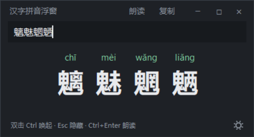
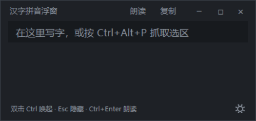
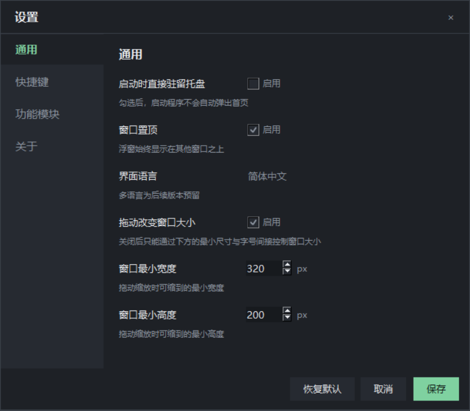
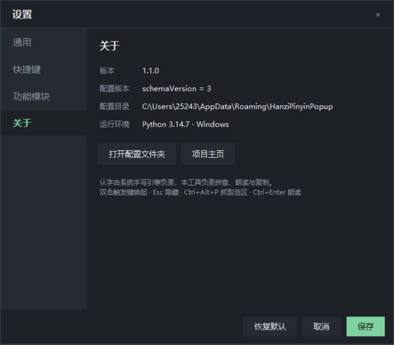
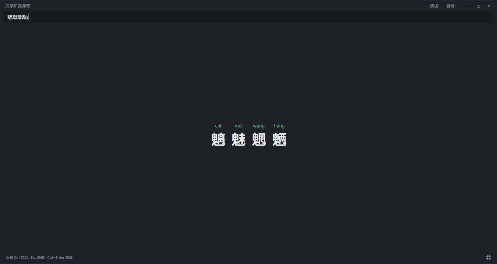

# 汉字拼音浮窗 · Hanzi Pinyin Popup

> 一个常驻系统托盘的小浮窗：随手写/打出一个不认识的字，立刻看到它的拼音，点一下还能读出来。

[](https://www.python.org/)
[](LICENSE)
[](#)
[](#)



## 为什么做这个

用 Windows 自带手写写生字，字能出来，但**系统不会告诉你它念什么**——微软拼音的手写面板只给候选汉字，没有拼音显示，也没有任何官方开关或补丁。

而开源的方案大多走另一条路：靠笔画拓扑匹配的引擎（HanziLookup / Zinnia 一类）识别率不高，写歪一点就给出一堆不相干的字，更别说标拼音了。

这个工具把两件事拆开：

- **认字**交给系统手写引擎（识别质量等同商业输入法，写歪了也能认）；
- **拼音、读音、复制**交给这个小浮窗。

于是流程变成：在浮窗里手写 → 字一上屏 → 拼音立刻显示在下面。

## 功能

**拼音相关**

- **实时拼音**：输入框内容一变，下方立刻显示每个汉字的拼音（带声调、自动分词）
- **多音字全列**：主读音按上下文判断（"重庆"读 chóng qìng），其余读音一并列出
- **一键朗读**：调用系统 TTS（Windows 用 SAPI，macOS 用 `say`，Linux 用 `spd-say`/`espeak`）
- **抓取选中文字**：任意程序里选中文字，按 `Ctrl+Alt+P`，浮窗读取选区并显示拼音
- **一键复制**：复制纯拼音（`chóng qìng`）或"字 + 拼音"对照

**顺手即查（v1.1.0 新增）**

- **选中双击出浮窗**：在任意程序里选中一段文字，双击鼠标，光标旁立刻弹出迷你浮窗显示拼音——不打开主窗口、不打断手上的事
- **不碰你的剪贴板**：用 Windows UI Automation 直接读选区，复制的内容始终是你原来的
- **点单字朗读**：点浮窗里的某一个字，只读这个字；多音字顺带切到下一个读音
- **标调三选一**：符号调 `hàn` / 数字调 `han4` / 无声调 `han`，随时切换
- **朗读嗓音可选**：跟随系统 / 女声优先 / 男声优先，或指定系统里某个具体嗓音
- **拖动改大小**：窗口八条边、四个角都能拖着改尺寸，最小 320×200，尺寸自动记住

**桌面集成（v1.0.0 新增）**

- **托盘常驻**：托盘右键菜单 **首页 / 设置 / 退出**，主窗口关掉也在后台待命
- **双击唤起**：默认**连按两下 Ctrl** 就能唤出首页；触发键可选 Ctrl / Alt / Shift / 空格 / Tab / F1–F12，双击间隔可调（默认 400 ms）
- **自定义标题栏**：右上角 `−` 隐藏到托盘、`□` 最大化（保留标题栏）、`×` 退出；按住标题栏任意空白处即可拖动窗口
- **统一设置界面**：托盘菜单或首页右下角齿轮进入同一个窗口，分「通用 / 快捷键 / 功能模块 / 关于」四组
- **配置带版本号**：`schemaVersion` + 迁移函数，升级不丢配置；加一个新设置项只需加一条配置定义
- **单实例运行**：重复启动只会唤出已有窗口，不会有第二个托盘图标
- 纯本地运行，不联网、不写注册表、不留后台服务

## 界面

| 首页（空状态） | 首页（有内容） |
| --- | --- |
|  |  |

| 设置 · 通用 | 设置 · 快捷键 |
| --- | --- |
|  |  |

| 设置 · 功能模块 | 设置 · 关于 |
| --- | --- |
|  |  |

点击 `□` 最大化后标题栏仍在，内容自动垂直居中（窗口不会盖住任务栏，托盘图标照样能点）：



选中文字后双击，光标旁弹出迷你浮窗（可拖动、可固定、超时淡出）：


## 快速开始

### Windows（推荐）

1. 安装 [Python 3.8+](https://www.python.org/downloads/)，安装时勾选 **Add python.exe to PATH**；
2. 下载本项目，双击 **`start.bat`**（首次会自动装依赖，之后直接启动）。

也可以手动来：

```bat
git clone https://github.com/LVE0CL/hanzi_pinyin.git
cd hanzi-pinyin-popup
python -m pip install -r requirements.txt
pythonw hanzi_pinyin.py
```

### macOS / Linux

```bash
git clone https://github.com/LVE0CL/hanzi_pinyin.git
cd hanzi-pinyin-popup
./run.sh
```

> macOS / Linux 上全局热键与托盘需要系统授权：macOS 要在「系统设置 → 隐私与安全性 → 辅助功能 / 输入监控」里放行；Linux 下的托盘依赖 GTK/AppIndicator（Debian/Ubuntu：`sudo apt install python3-gi gir1.2-appindicator3-0.1`）。这块未做深度适配，欢迎提 PR。

## 三种用法

### 1. 配合系统手写（主要场景）

1. 连按两下 `Ctrl` 唤出浮窗，光标会自动落在输入框；
2. 唤出 Windows 触摸键盘（任务栏键盘图标），左上角齿轮 → **手写**；
3. 用鼠标、触摸板、触屏或数位板写字，字会输入到输入框；
4. 拼音立刻出现在字的下方，点 **朗读** 听读音，点 **复制** 拿到拼音。

> 触摸板也能写：按住触摸板拖动就是在画笔画，抬手即断笔。想更顺手就把指针速度调慢、关掉"轻点以单击"。

### 2. 选中文字后双击（最快）

在浏览器、PDF、Word、记事本里选中一段文字，**双击鼠标左键**（不要拖选，选好再点两下），光标旁立刻弹出迷你浮窗：

- 点 `朗读` 整段读一遍，点某个字只读这个字；
- 点 `复制` 拿到拼音，右键还有「字 + 拼音」对照；
- 点 `固定` 就让它待着，否则默认 4 秒后淡出。

> 读选区走的是 Windows UI Automation，**不会动你的剪贴板**——剪贴板里原来复制的文件、链接都还在。
> 也正因为如此，它只对暴露了文本接口的控件有效（记事本、Word、浏览器正文、大部分编辑框）；落在文件列表、桌面、按钮上时双击完全不受影响。

### 2.1 抓取别处的文字（热键方式）

按 `Ctrl+Alt+P` 也行，效果一样。这条路径在 UI Automation 读不到时会**兜底**：备份剪贴板 → 模拟 `Ctrl+C` → 读完还原，你原来的复制内容不会丢。

### 3. 直接粘贴

把字粘进输入框即可，长句会自动折行，超过半屏高时出现滚动条。

## 快捷键

| 快捷键 | 作用 |
| --- | --- |
| **选中文字后双击鼠标左键** | 光标旁弹出迷你浮窗查拼音（按钮与修饰键可改） |
| **双击 `Ctrl`** | 唤起 / 前置首页（触发键可在设置里改） |
| `Ctrl+Alt+P` | 抓取当前选中文字（可改为 Ctrl+Shift+P / Alt+Shift+P） |
| `Ctrl+Alt+Q` | 退出程序 |
| `Esc` | 隐藏到托盘（进程仍在，双击触发键随时唤回） |
| `Ctrl+Enter` | 朗读当前内容 |

窗口按钮（右上角，从右至左）：

| 按钮 | 作用 |
| --- | --- |
| `×` | **退出**程序（连托盘图标一起清理） |
| `□` | 最大化 / 还原（最大化时保留标题栏，且不遮挡任务栏） |
| `−` | **隐藏**到托盘，进程继续运行 |

> 按住标题栏空白处拖动可以移动窗口；最大化状态下拖动自动禁用。
> 窗口四边与四角还有 6px 的缩放热区，鼠标移上去会变成双向箭头，按住即可改大小。

迷你浮窗上从右往左是 `×` 关闭、`固定`、`朗读`、`复制`；点一个字只读这个字，多音字顺便切换读音。

## 设置

两个入口，开着的是同一个窗口（单实例）：

- 托盘右键 → **设置**
- 首页右下角**齿轮图标**

| 分组 | 内容 |
| --- | --- |
| 通用 | 启动时直接驻留托盘、窗口置顶、界面语言（预留）、拖动改大小、窗口最小宽高 |
| 快捷键 | 双击唤起的按键、双击判定间隔（150–1000 ms）、抓取选中文字的热键、选中双击（开关/鼠标键/修饰键）、优先查询选区 |
| 功能模块 | 剪贴板自动识别、汉字字号、朗读语速、朗读嗓音、点单字朗读、抓取不破坏剪贴板、标调方式、浮窗自动淡出、浮窗默认固定、界面主题 |
| 关于 | 版本号、配置版本（`schemaVersion`）、配置目录、运行环境、项目主页 |

底部三个按钮：**恢复默认 / 取消 / 保存**。保存后立刻生效并写入磁盘，重启后保留。

## 配置文件

首次运行后生成：

- Windows：`%APPDATA%\HanziPinyinPopup\config.json`
- macOS：`~/Library/Application Support/HanziPinyinPopup/config.json`
- Linux：`~/.config/HanziPinyinPopup/config.json`

写入采用「临时文件 + fsync + 原子替换」，断电或强杀不会留下半截文件。

| 字段 | 默认值 | 说明 |
| --- | --- | --- |
| `schemaVersion` | `3` | 配置版本，用于升级迁移 |
| `start_hidden` | `false` | 启动后只驻留托盘，不弹窗 |
| `always_on_top` | `true` | 是否置顶 |
| `resize_enabled` | `true` | 允许拖动边缘改大小 |
| `resize_pad` | `6` | 边缘缩放热区厚度（px） |
| `min_width` / `min_height` | `320` / `200` | 缩放的下限 |
| `trigger_key` | `"ctrl"` | 双击唤起的按键（`ctrl`/`alt`/`shift`/`space`/`tab`/`f1`…`f12`） |
| `double_click_ms` | `400` | 双击判定间隔（毫秒，150–1000） |
| `hotkey` | `"<ctrl>+<alt>+p"` | 抓取选区热键，[pynput 语法](https://pynput.readthedocs.io/en/latest/keyboard.html#global-hotkeys) |
| `quit_hotkey` | `"<ctrl>+<alt>+q"` | 退出热键 |
| `select_double_popup` | `true` | 选中文字后双击弹迷你浮窗 |
| `select_double_button` | `"left"` | `left` / `right` / `middle` |
| `select_double_modifier` | `"none"` | `none` / `ctrl` / `alt` / `shift` |
| `trigger_prefers_selection` | `false` | 双击触发键时有选区则弹浮窗而不是首页 |
| `auto_clipboard` | `false` | 打开后，剪贴板出现汉字就自动显示拼音 |
| `font_size` | `32` | 汉字字号（像素近似值） |
| `speech_rate` | `0` | 语速，`-10` ~ `10` |
| `tts_voice` | `"auto"` | `auto` / `female` / `male` / 具体 SAPI 嗓音名 |
| `read_char_on_click` | `true` | 点单字只读这个字 |
| `preserve_clipboard` | `true` | 抓取选区后还原剪贴板 |
| `tone_style` | `"symbol"` | `symbol` / `num` / `none` |
| `theme` | `"dark"` | `dark` / `light`（切换后重启生效） |
| `mini_popup_auto_hide_ms` | `4000` | 浮窗停留时长，0 = 不自动消失 |
| `mini_popup_pinned` | `false` | 浮窗默认固定 |
| `window_width` / `window_height` | `420` / `200` | 窗口尺寸，拖动或隐藏时自动记录 |
| `position` | `null` | 窗口位置，隐藏/退出时自动记录 |

## 常见问题

**双击 Ctrl 没反应？**

1. 先看托盘图标在不在——在就说明程序活着，多半是按键被别的软件抢走了（截图工具、录屏、输入法都可能）。去设置里换一个触发键（比如双击 `Alt`）试试。
2. 有的安全软件会拦截全局键盘监听，需要放行本程序。
3. macOS 需要在「系统设置 → 隐私与安全性 → 辅助功能」里授权；Wayland 下全局监听受限，建议切到 X11 会话。

**托盘图标不见了？**

程序启动时如果托盘初始化失败，会把窗口直接显示出来并在控制台打印原因（用 `python hanzi_pinyin.py` 前台运行可以看到）。Linux 下通常是缺 AppIndicator 依赖。

**选中文字后双击没反应？**

1. 先确认「设置 → 快捷键 → 选中双击弹浮窗」是开着的；
2. 这个功能依赖 `uiautomation`（`pip install -r requirements.txt` 会一起装）。没装或控件不暴露文本接口时，双击不会触发——这是刻意的：宁可不动，也不要在资源管理器里双击时替你按 `Ctrl+C` 把文件复制走；
3. 如果和你常用软件的双击手势撞了，可以在设置里给这个手势加一个修饰键（按住 `Ctrl`/`Alt`/`Shift` 再双击）；
4. 兜底路径只在光标确实落在文本控件上时才启用。

**想让双击 Ctrl 直接查选中的词？**

打开「设置 → 快捷键 → 优先查询选区」：有选区时双击触发键弹迷你浮窗，没选区时照旧唤起首页。

**拖不到窗口边缘改大小？**

窗口边缘只有 6px 的热区，最大化状态下会禁用。嫌难点可以把 `config.json` 里的 `resize_pad` 调大到 8~10。

**朗读没有男声？**

Windows 默认只装了一两个嗓音（通常只有女声）。去「设置 → 时间和语言 → 语音 → 添加语音」装一个中文语音包，回到「设置 → 功能模块 → 朗读嗓音」就能选到具体嗓音。

**点朗读没声音？**

Windows 首次调用 SAPI 有 0.5 秒左右启动延迟，属正常。若完全无声，检查系统默认播放设备，或在「设置 → 时间和语言 → 语音」里确认已安装中文语音包。

**识别出来的字不对？**

识别由系统手写引擎负责，尽量写大、写正、按标准笔顺。候选不对就在手写面板里点其他候选，或退回用输入法的 U 模式。

**多音字标错了？**

单字无法判断语境（"行"默认 xíng，"银行"才是 háng）。输入词组即可，工具会把整串一起送进词典消歧。多音字行里也列出了其他读音。

**杀毒软件报毒？**

程序用 `pynput` 做全局按键监听、用 PowerShell 调系统语音，这两点容易触发启发式误报。代码全部开源，可自行审阅；也可以在设置里关掉相关功能来避开。

## 工作原理

```
输入框内容 ──► pypinyin（整串送词典消歧）──► 逐字渲染音标 + 多音字
     ▲
     ├── 系统手写 / 输入法 / 粘贴
     └── Ctrl+Alt+P ──► 模拟 Ctrl+C ──► 读剪贴板

双击触发键 ──► pynput 监听线程 ──► 队列 ──► Tk 主线程唤起窗口
托盘菜单  ──► pystray 线程    ──► 队列 ──┘
```

- 界面：`tkinter`（标准库，无额外 GUI 依赖），无边框 + 自绘标题栏
- 拼音：`pypinyin`（MIT）
- 托盘：`pystray` + `Pillow`（图标运行时绘制，不依赖图片资源）
- 全局按键：`pynput`
- 剪贴板：`pyperclip`
- 读选区：Windows `uiautomation`（TextPattern），读不到再走剪贴板备份还原
- 朗读：Windows 下常驻一个 PowerShell `System.Speech` 进程（文本走 base64 传输，避开控制台编码问题），其他平台走系统命令

> 托盘线程、键盘监听、鼠标监听都不直接碰 Tk —— 它们把回调塞进队列，由主线程每 60 ms 取一次执行，避免 `main thread is not in main loop`。
> UI Automation 的 COM 初始化是按线程的，所以读选区一律在刚起的短线程里做，读完再 `post()` 回主线程。

## 开发

核心只有一个文件，改起来没有负担：

```bash
python hanzi_pinyin.py --selftest        # 不启动界面，验证拼音与配置
python hanzi_pinyin.py --text 重庆银行    # 启动时预填内容
python hanzi_pinyin.py --hidden          # 启动后只驻留托盘
python hanzi_pinyin.py --version
```

### 加一个设置项

`SETTING_GROUPS` 是声明式的：往对应分组里加一条 dict，再在 `DEFAULT_CONFIG` 里加一条默认值，设置界面、保存、校验、恢复默认都会自动带上它，不用改主流程。

```python
{"key": "my_option", "label": "我的开关", "type": "bool", "hint": "说明文字"}
```

支持的 `type`：`bool` / `int`（带 `min`/`max`/`step`/`suffix`）/ `choice`（带 `choices=[(显示名, 存储值)]`，可选 `readonly`）。

### 升级配置结构

1. `CONFIG_SCHEMA` +1；
2. 在 `migrate()` 里补一段 `if v < N: ...` 的转换；
3. 老配置会在下次启动时自动升级。

### 迭代方式

每次迭代都在 `开发文档.md` 里写需求（结构：目标 / 范围 / 用户故事与验收 / 设置架构 / 技术约束 / 任务拆分），做完后归档到 `开发文档归档文件夹/第N次开发文档.md`，再把 `开发文档.md` 换成下一次的待办模板。规则见 [开发规范.md](开发规范.md)。

欢迎提 Issue / PR。想加的方向：

- [x] 托盘图标 / 双击唤起 / 统一设置界面
- [x] 拖动改变窗口大小（八向热区）
- [x] 选中文字双击弹迷你浮窗 / 贴光标定位 / 固定 / 超时淡出
- [x] 朗读嗓音可选、点单字朗读、抓取选区不破坏剪贴板
- [x] 标调方式切换（符号 / 数字 / 无声调）、多音字点击切换
- [ ] 生词本与历史记录
- [ ] 部首、笔画数、简单释义（接 CC-CEDICT）
- [ ] 开机自启（Windows 注册表 / macOS LaunchAgent / Linux autostart）
- [ ] 整段批量转拼音 + 导出
- [ ] 多语言界面（配置里已留 `language` 字段）
- [ ] 内置手写板（直接调 Windows Ink 引擎，省掉切换输入法这一步）

## 许可证

[MIT](LICENSE)。拼音数据来自 [pypinyin](https://github.com/mozillazg/python-pinyin)（MIT）。

---

<sub>拼音数据来自 pypinyin；如果你fork了本项目，记得把 `LICENSE`、`README` 和 `PROJECT_URL` 换成自己的仓库地址。</sub>
